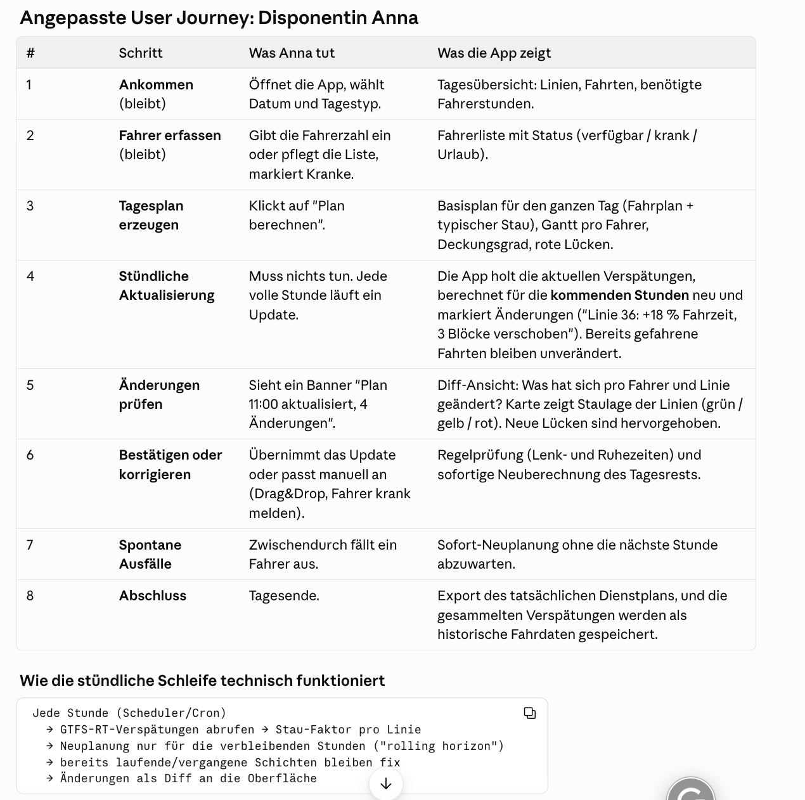

# Busplaner Nürnberg

Dienstplanung für Busfahrer, die knapp sind. Aus dem echten Fahrplan, den gesetzlichen Lenk- und Ruhezeiten und der aktuellen Verkehrslage berechnet die App in wenigen Sekunden, welcher Fahrer welche Fahrt übernimmt. Fällt ein Fahrer aus, zeigt sie sofort, welche Fahrten unbesetzt bleiben.

Entstanden beim Claude Impact Lab in Nürnberg, Track "Express-Busse trotz Fahrermangel".

**Live ansehen:** [Artifact](https://claude.ai/artifact/MRHHYTDEGgpuXpwL2BUjRH). Läuft komplett im Browser (Beispielfahrer, simulierter Stau). Der Link ist privat, bis das Artifact freigegeben wird.



## Was die App kann

- **Tagesplan** für alle Nürnberger Stadtbuslinien: rund 5.200 Fahrten an einem Werktag, 117 Linien im Datensatz.
- **Fahrer anpassen:** Fahrerzahl per Regler ändern, einzelne Fahrer krank melden. Der Plan rechnet sofort neu, Lücken werden rot angezeigt, mit Grund (Lenkzeit, Pause, im Einsatz).
- **Dienstplan pro Fahrer:** Schicht, Fahrten mit Strecke, Pausen und Regel-Check, als CSV exportierbar.
- **Abdeckung je Linie:** ein Gantt-Diagramm mit Linien auf der Y-Achse und der Tageszeit auf der X-Achse, das zeigt, wann welche Linie besetzt ist.
- **Filter nach Buslinie** für alle Ansichten.
- **Verkehrslage:** Live-Verspätungen der VAG fließen in die Fahrzeiten ein, der Zuschlag klingt über zwei Stunden ab. Alternativ simulierte Störungen für Demos.
- **Stündliche Aktualisierung:** Gefahrene Fahrten bleiben fix, der Rest des Tages wird neu geplant.

## Datenquellen

| Daten | Quelle |
|---|---|
| Linien, Fahrten, Haltestellen | VGN-Fahrplandaten (GTFS), gefiltert auf Nürnberger VAG-Stadtbusse, siehe `scripts/extract_vag_buses.py` |
| Live-Verspätungen | VAG-Echtzeitschnittstelle (PULS), 18 Stationen decken alle Linien ab, siehe `lib/vag-live.ts` |
| Fahrer, Abwesenheiten, Verspätungshistorie | Supabase (Postgres), Schema in `db/schema.sql` |

Die Fahrer sind **synthetisch** (400 erfundene Personen). Die Fahrplandaten sind echt.

## Wie der Scheduler arbeitet

`lib/scheduler.ts` ist eine reine Funktion: Fahrten, Fahrer und Stau-Faktoren hinein, Plan heraus. Eine Greedy-Heuristik sortiert die Fahrten nach Abfahrt und gibt jede dem am besten passenden Fahrer, wenn

- er den Startpunkt rechtzeitig erreicht (Wendezeit plus Leerfahrt),
- seine Lenkzeit höchstens 9 Stunden beträgt,
- nach 4,5 Stunden Lenkzeit eine Pause von 45 Minuten möglich ist,
- die Schicht höchstens 13 Stunden dauert.

Ein Teil der Fahrer startet erst ab 14 Uhr (Spätschicht-Reserve), sonst fehlen abends alle. Findet sich niemand, bleibt die Fahrt unbesetzt und wird mit Grund gemeldet.

Das ist ein regelbasierter Algorithmus und keine KI. Er ist schnell und nachvollziehbar, findet aber nicht immer die beste Lösung.

## Starten

Voraussetzung: Node.js 24 oder neuer.

```bash
npm install
npm run dev        # http://localhost:3000
npm test           # alle Tests
```

Ohne Supabase-Zugang läuft die App mit Beispielfahrern. Für die echten Fahrer aus der Datenbank eine Datei `.env.local` anlegen (Vorlage: `.env.local.example`):

```
NEXT_PUBLIC_SUPABASE_URL=...
SUPABASE_SERVICE_ROLE_KEY=...     # nur serverseitig, niemals committen
```

Verspätungen aufzeichnen: `/api/record` stündlich aufrufen (zum Beispiel über einen externen Zeitgeber). Daraus lernt die Ansicht `traffic_factors` die typische Grundlast je Linie, Wochentag und Stunde.

Eigenständige Browser-Version (das Artifact) neu bauen:

```bash
npm run build:artifact     # erzeugt dist/busplaner-artifact.html
```

## Aufbau

```
app/api/plan        Plan berechnen (Server)
app/api/traffic     aktuelle Verspätungen je Linie
app/api/record      Verspätungen in Supabase speichern
components/         Oberfläche (Dashboard, Dienstplan pro Fahrer)
lib/scheduler.ts    Planungslogik
lib/plan-service.ts gemeinsame Berechnung für Server und Browser
lib/traffic.ts      Stau-Faktoren (Live, Historie, Simulation)
lib/vag-live.ts     Abruf der VAG-Verspätungen
data/               kompakte Bus-Daten (JSON)
db/schema.sql       Datenmodell für Supabase
artifact/           eigenständige Browser-Version
tests/              Tests für Scheduler, Verkehr, Filter, Dienstplan
```

## Grenzen

- Die Verspätung an einer Haltestelle ist nur ein Näherungswert für den Stau auf der ganzen Strecke.
- Die Schichten sind regelkonform, aber nicht kompakt: Fahrer können lange Wartezeiten und Linienwechsel haben.
- Beim Aktualisieren verschieben sich viele Zuordnungen. Der Plan ist noch nicht stabil.
- Die OpenStreetMap-Karte ist noch nicht eingebaut.
- Krankmeldungen gelten nur in der laufenden Sitzung und werden noch nicht in Supabase gespeichert.
