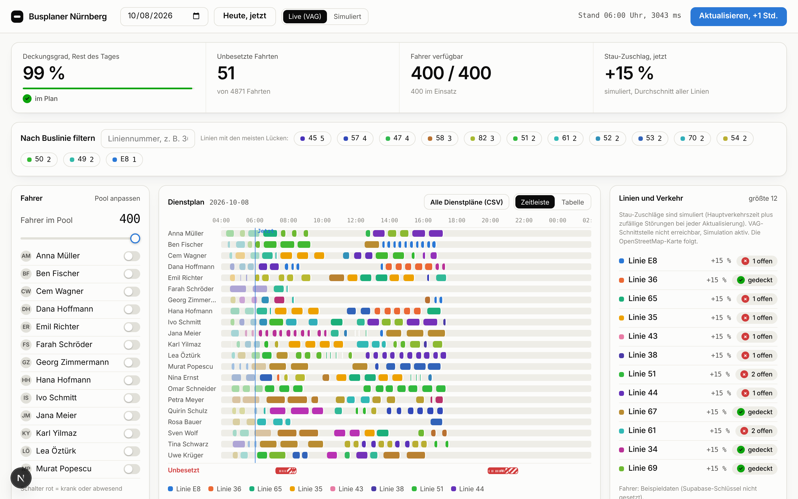

# Busplaner Nürnberg

🏆 **Winner of the Claude Impact Lab Nuremberg (October 2026)**, track "Express buses despite the driver shortage".

Shift planning for bus companies that are short of drivers. From the real timetable, the legal driving and rest-time rules and the current traffic situation, the app works out in a few seconds which driver takes which trip. When a driver calls in sick, it shows immediately which trips will go unstaffed.

*[Deutsche Version](README.de.md)*



**Live demo:** [Claude artifact](https://claude.ai/artifact/MRHHYTDEGgpuXpwL2BUjRH). Runs entirely in the browser with sample drivers and simulated traffic. The link stays private until the artifact is shared.


## What the app does

- **Daily plan** for all Nuremberg city bus lines: around 5,200 trips on a weekday, 117 lines in the dataset.
- **Adjust the driver pool:** change the number of drivers with a slider or mark individual drivers as sick. The plan recalculates instantly, and gaps are shown in red with the reason (driving time, break, already on duty).
- **Roster per driver:** shift, trips with route, breaks and a rule check, exportable as CSV.
- **Coverage per line:** a Gantt chart with lines on the y-axis and time of day on the x-axis, showing when each line is staffed.
- **Filter by bus line** across all views.
- **Traffic:** live delays from VAG feed into travel times, with the surcharge fading out over two hours. Simulated disruptions are available for demos.
- **Hourly refresh:** trips already driven stay fixed, and the rest of the day is replanned.

## Data sources

| Data | Source |
|---|---|
| Lines, trips, stops | VGN timetable data (GTFS), filtered to Nuremberg VAG city buses, see `scripts/extract_vag_buses.py` |
| Live delays | VAG real-time interface (PULS), 18 stations cover all lines, see `lib/vag-live.ts` |
| Drivers, absences, delay history | Supabase (Postgres), schema in `db/schema.sql` |

The drivers are **synthetic** (400 invented people). The timetable data is real.

## How the scheduler works

`lib/scheduler.ts` is a pure function: trips, drivers and traffic factors go in, a plan comes out. A greedy heuristic sorts trips by departure and gives each one to the best-fitting driver, provided that

- they can reach the starting point in time (turnaround plus empty run),
- their driving time stays at or below 9 hours,
- a 45-minute break is possible after 4.5 hours of driving,
- the shift lasts no more than 13 hours.

Some drivers only start from 2 pm (late-shift reserve), otherwise evening trips would go uncovered. If nobody fits, the trip stays unstaffed and is reported with the reason.

This is a rule-based algorithm, not AI. It is fast and explainable, but it does not always find the optimal solution.

## Run it

Requires Node.js 24 or newer.

```bash
npm install
npm run dev        # http://localhost:3000
npm test           # all tests
```

Without Supabase access, the app runs with sample drivers. To use the real drivers from the database, create a `.env.local` file (template: `.env.local.example`):

```
NEXT_PUBLIC_SUPABASE_URL=...
SUPABASE_SERVICE_ROLE_KEY=...     # server-side only, never commit
```

Recording delays: call `/api/record` every hour (for example from an external scheduler). From this, the `traffic_factors` view learns the typical baseline per line, weekday and hour.

Rebuild the standalone browser version (the artifact):

```bash
npm run build:artifact     # creates dist/busplaner-artifact.html
```

## Structure

```
app/api/plan        calculate the plan (server)
app/api/traffic     current delays per line
app/api/record      store delays in Supabase
components/         interface (dashboard, roster per driver)
lib/scheduler.ts    planning logic
lib/plan-service.ts shared calculation for server and browser
lib/traffic.ts      traffic factors (live, history, simulation)
lib/vag-live.ts     fetching VAG delays
data/               compact bus data (JSON)
db/schema.sql       data model for Supabase
artifact/           standalone browser version
tests/              tests for scheduler, traffic, filters, roster
```

## Limitations

- The delay at one stop is only an approximation of congestion along the whole route.
- Shifts follow the rules but are not compact: drivers can have long waits and line changes.
- Many assignments shift when the plan is refreshed. The plan is not yet stable.
- The OpenStreetMap view is not built in yet.
- Sick reports only apply to the current session and are not yet saved to Supabase.
